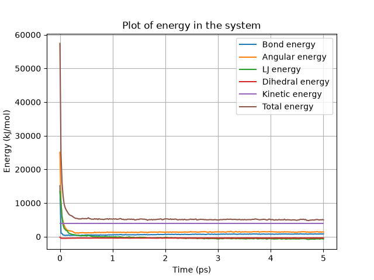
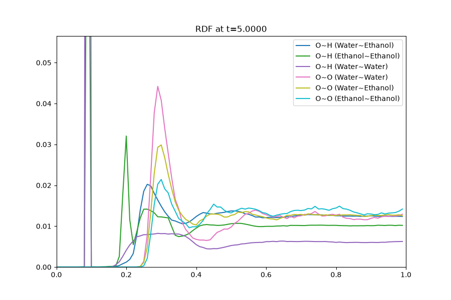

# Molecular Modelling OJ

A classical molecular dynamics (MD) simulator for mixtures of small molecules
(water, ethanol, oxygen, hydrogen) in a periodic cubic box, written in Python
with NumPy, SciPy and Numba.

Given a box size and a mixing ratio, it:

- fills the box with molecules at liquid density;
- relaxes atomic overlaps;
- integrates Newton's equations of motion with a choice of four integrators.

It writes the trajectory as `.xyz` (readable by VMD and similar tools) and
plots the energy, temperature, bond phase-space diagrams and radial
distribution functions (RDFs).

<p align="center">
  
  
</p>

## Installation

Requires Python 3.11 or newer.

```bash
git clone <repository-url>
cd molecular_modelling_oj
pip install -e .            # or: pip install -e .[dev]  (adds pytest and ruff)
```

`requirements.txt` pins the versions this was last tested with
(`pip install -r requirements.txt`).

## Quick start

```bash
python -m mdsim -c configs/quick.toml
```

This is a 2 nm box with water and ethanol, run for 5 ps, and takes about a
minute. The results land in `trajectories/<system>/<run settings>/`.

The full default run is a 4 nm box simulated for 200 ps:

```bash
python -m mdsim -c configs/default.toml --seed 1
```

Command line options override the config file:

| Option | Meaning |
|---|---|
| `-c FILE`, `--config FILE` | TOML settings file. Without it, the built-in defaults are used (identical to `configs/default.toml`). |
| `-w NAME=WEIGHT`, `--weight` | Relative amount of a molecule; repeat it for each molecule, e.g. `-w Water=3 -w Ethanol=1`. Replaces all weights from the config. |
| `--seed N` | Random seed, for reproducible runs. |
| `--no-show` | Save the figures without opening windows. |

You can also run it from Python:

```python
from mdsim import load_config, run

config = load_config("configs/quick.toml", weights={"Water": 1.0}, seed=2)
folder = run(config)
```

## Configuration

Settings are read from a TOML file; every setting is optional.
[`configs/default.toml`](configs/default.toml) lists all of them with
comments. Paths in a config file are relative to that file.

| Section | Key | Default | Meaning |
|---|---|---|---|
| (top) | `seed` | random | Seed for all random choices (grid placement, velocities, RDF thinning). |
| `[system]` | `boxsize` | `4.0` | Edge length of the cubic box (nm). |
| | `weights` | `{Water = 1, Ethanol = 1}` | Relative amount of each molecule (normalised). |
| | `random_grid_offset` | `0.0` | Random shift of molecules from their grid points, in grid spacings (−0.5 to 0.5). |
| | `r_threshold_scalar` | `0.65` | Soft start: push LJ pairs apart until none is closer than this many σ. Omit to skip it. |
| | `molecule_dir` | built-in | Folder with `<Name>.xyz` and `<Name>.itp` files. |
| `[integration]` | `method` | `"velocity_verlet"` | `euler`, `verlet`, `velocity_verlet` or `beeman`. |
| | `dt` | `0.001` | Time step (ps). |
| | `end_time` | `200.0` | Simulated time (ps). |
| | `save_steps` | `100` | Record measurements and a trajectory frame every this many steps. |
| | `initial_temp` | `298.15` | Initial (and target) temperature (K). |
| | `temp_control` | `true` | Rescale the velocities to `initial_temp` every step. |
| `[lennard_jones]` | `r_cutoff_scalar` | `2.0` | LJ cutoff as a multiple of σ. `0` disables LJ; `inf` keeps all pairs. |
| | `f_threshold` | unset | Alternative to `r_cutoff_scalar`: neglect LJ forces below this (kJ/(mol·nm)). Set exactly one of the two. |
| | `neighbour_skin` | `0.1` | Extra neighbour-list distance (nm). Affects speed only, not results. |
| `[output]` | `directory` | `"trajectories"` | Where run folders are created. |
| | `show_plots` | `true` | Open each figure in a (blocking) window; figures are always saved. |
| | `vmd_path` | `C:/Program Files/VMD/vmd.exe` | VMD executable, used when `plots.vmd = true`. |
| `[plots]` | `energy`, `temperature`, `phase_space`, `computation_time`, `rdf` | `true` | Which figures to make. |
| | `vmd` | `false` | Open the trajectory in VMD at the end. |
| `[phase_space]` | `bonds` | water O–H, ethanol O–H, C–O, C–H, oxygen O–O | Bond types to plot, as `"O-H (Water)"`. |
| `[rdf]` | `pairs` | six O~H and O~O pairs | Pairs to plot, as `"O~H (Water~Ethanol)"`: an O atom in a water molecule with an H atom in an ethanol molecule. |
| | `thin` | `1.0` | Fraction of the pairs to sample (0 < thin ≤ 1). |
| | `dr` | `0.005` | Histogram bin width (nm). |
| | `gif_frames` | `200` | Maximum number of frames per RDF gif; the statistics use every saved frame. |

## Output

Each run writes to
`<directory>/boxsize=…_roff=…__<mixture>/dt=…_T=…_steps=…_<cutoff>_temp=…_control=…/`.
Running the same settings again overwrites the previous results.

| File | Contents |
|---|---|
| `INITIAL.xyz`, `INITIAL.itp` | Starting configuration (after the soft start) and the force field of the whole system. |
| `INTEGRATED.xyz` | Trajectory: one frame every `save_steps` steps, with whole molecules wrapped into the box. |
| `energy.png` | Bond, angle, LJ, dihedral, kinetic and total energy over time. |
| `temperature.png` | Temperature over time. |
| `ps_diagram/ps_diag_<bond>.png` | Bond length against its rate of change, for each tracked bond. |
| `RDF/RDF.gif`, `RDF/<pair>/RDF_<pair>.gif` | Evolution of the RDFs (running mean, with confidence interval per pair), plus first/last frame PNGs. |
| `comptimes_piechart.png` | Where the computation time went. |

## Model

All units are internal: nm, ps, amu, kJ/mol and K.

**Force field.** The potential energy is the sum of four terms:

- **Bonds** (harmonic): $E = \tfrac12 k_b (r - r_0)^2$
- **Angles** (harmonic): $E = \tfrac12 k_\theta (\theta - \theta_0)^2$
- **Dihedrals** (Ryckaert–Bellemans):
  $E = \tfrac12\left[C_1(1+\cos\phi) + C_2(1-\cos 2\phi) + C_3(1+\cos 3\phi) + C_4(1-\cos 4\phi)\right]$
- **Lennard-Jones**: $E = 4\varepsilon\left[(\sigma/r)^{12} - (\sigma/r)^6\right]$ for $r$ below the cutoff.
  - It uses Lorentz–Berthelot mixing: $\sigma_{ij} = (\sigma_i+\sigma_j)/2$, $\varepsilon_{ij} = \sqrt{\varepsilon_i\varepsilon_j}$.
  - Atom pairs that share a bond, angle or dihedral get no LJ, and neither do atoms with ε = 0.
  - Distances use the minimum image convention.

**Integration.** You can choose Euler, Verlet, velocity Verlet or Beeman. The
first step is always an Euler step, because the other methods need the
previous step.

With `temp_control`, all velocities are rescaled to the target temperature
after every step (Verlet rescales its last displacement instead). The
temperature uses $N_f = 3N$ degrees of freedom.

**Setup.**

- **Packing.** Molecules are placed on a cubic grid. Each molecule type is
  rotated so that it fits in the smallest box, then given random grid sites.
  The number of molecules comes from the pure-component molar volumes in
  [`constants.py`](src/mdsim/constants.py).
- **Soft start.** Integrates from rest with the LJ forces capped, until no LJ
  pair is closer than `r_threshold_scalar`·σ.
- **Starting velocities.** Random velocities, scaled to the initial
  temperature.

**Approximations to be aware of**

- **No electrostatics.** There are no partial charges, so hydrogen bonding
  is essentially absent. Water's H atoms have no LJ either.
- **Truncated LJ.** LJ is cut off sharply, without a shift or tail
  correction, so energy and force jump at the cutoff.
- **Thermostat.** Rescaling every step gives an isokinetic ensemble: the
  temperature does not fluctuate, so it is not canonical.
- **Starting velocities** are drawn from N(0, 1) for every atom and then
  scaled together. They are not Maxwell–Boltzmann distributed, and the
  centre-of-mass momentum is not removed.
- **RDF normalisation.** The RDF is normalised to its shape (divided by
  shell volume, then by its sum). It is not a density-normalised g(r) that
  tends to 1, and it includes pairs within one molecule. The confidence
  intervals treat successive frames as independent.

## Molecules

Each molecule needs three things:

- a `<Name>.xyz` geometry, in Å;
- a `<Name>.itp` force field, in the format below;
- an entry in `MOLAR_VOLUMES` in
  [`src/mdsim/constants.py`](src/mdsim/constants.py).

Built-in molecules live in
[`src/mdsim/data/molecules/`](src/mdsim/data/molecules). To add your own,
put the two files in a folder and set `molecule_dir`.

The `.itp` format is specific to this project (it is not GROMACS). Atom
indices start at 0:

```
bonds N        then N lines:  i j k_b r0             (k_b in kJ/(mol·Å²)/100, r0 in Å)
angles N       then N lines:  i j k k_theta theta0   (kJ/(mol·rad²), rad; j is the middle atom)
dihedrals N    then N lines:  i j k l C1 C2 C3 C4    (kJ/mol)
atoms N        then N lines:  epsilon sigma mass     (kJ/mol, nm, amu)
```

## Performance

Measured on the default system, a 4 nm box of water and ethanol with 8,376
atoms:

- **One time step:** about 46 ms, roughly 2.7 h for the full 200 ps run.
- **Previous version:** about 2.4 s per step.

The speed-up comes from three changes:

- **Neighbour list.** LJ forces use a Verlet neighbour list built with a
  periodic k-d tree and rebuilt once an atom has moved more than half the
  skin, so only about 3% of all atom pairs are visited each step. The result
  equals an all-pairs computation up to rounding.
- **Compiled kernels.** LJ forces and RDF histograms run in Numba kernels.
- **Bonded forces** are gathered in a single vectorised pass.

## Known limitations

- **Default soft start.** In the default 4 nm box, the soft start (which
  runs without a thermostat) heats the system to thousands of kelvin, and it
  can take a very long time to separate every pair. `configs/quick.toml`
  does not have this problem.
- **O₂ and H₂ density.** The molar volumes for Oxygen and Hydrogen (22.4)
  look like the ideal-gas value in L/mol, but they are used as cm³/mol. This
  packs those gases at liquid-like density.
- **Dihedral forces** divide by the sine of the neighbouring bond angles, so
  they become singular if a bond angle reaches 180°. That can happen in
  violent dynamics, such as an unrelaxed start.

## Development

```bash
python -m pytest            # 67 tests, ~20 s
ruff check src tests        # linting (pip install ruff)
```

The tests include checks that every force term equals minus the numerical
gradient of its energy, that velocity Verlet conserves energy, that the
thermostat reaches its target, and that results are reproducible with a
seed.

```
configs/           example settings (default.toml documents every option)
src/mdsim/
  cli.py           command line interface (python -m mdsim)
  config.py        Config dataclass, TOML loading and validation
  constants.py     physical constants, molar volumes
  data/molecules/  built-in .xyz/.itp files
  io.py            .xyz and .itp readers/writers
  system.py        Topology, building the initial box, velocities
  geometry.py      distances, minimum image, angle/dihedral geometry
  neighbours.py    LJ exclusions and the Verlet neighbour list
  forcefield.py    force and energy terms, ForceField
  integrators.py   integration methods and a single step
  simulation.py    soft start, main loop, output
  observables.py   phase space and RDF recording
  plotting.py      figures
  vmd.py           launching VMD
tests/             pytest suite
```

## Authors

<!-- Authors to be added. -->
