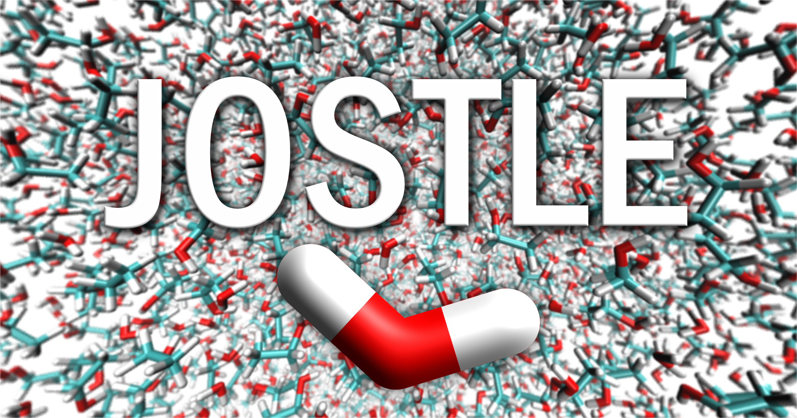
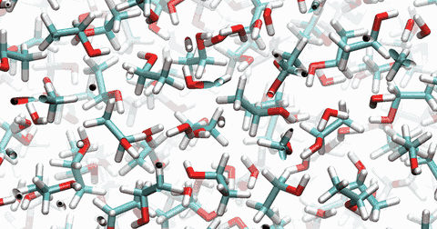

<p align="center">
  
</p>

# Jostle

*Justin's & Olivier's Simulator of Thermal Liquid Ensembles.*

A classical molecular dynamics simulator for mixtures of small molecules
(water, ethanol, oxygen, hydrogen) in a periodic cubic box, written in Python
with NumPy, SciPy and Numba and driven from a Jupyter notebook.

<p align="center">
  
</p>

Given a box size and a mixing ratio, jostle:

- **builds** the box: molecules at liquid density on random sites, then
  packed as rigid bodies until no atoms overlap;
- **integrates** the motion with Euler, Verlet, velocity Verlet or Beeman,
  with an optional thermostat;
- **records** the trajectory (`.xyz`, viewable in VMD), the energies,
  temperature, bond phase-space diagrams and radial distribution functions
  (RDFs) with confidence intervals.

The force field has harmonic bonds and angles, Ryckaert–Bellemans dihedrals
and shifted-force Lennard-Jones (no electrostatics). A Verlet neighbour list
and compiled Numba kernels give about 60 ms per step for 8,000 atoms.

<p align="center">
  
  
</p>

## Installation

Requires Python 3.11 or newer.

```bash
git clone <repository-url>
cd jostle
pip install -e .[notebook]  # adds JupyterLab; use .[dev] for pytest and ruff
```

`requirements.txt` pins the versions this was last tested with.

## Quick start

Open [`notebooks/jostle.ipynb`](notebooks/jostle.ipynb) in Jupyter and run all
cells: it simulates a 2 nm box of water and ethanol for 5 ps (a few minutes)
and walks through the results. In short:

```python
from jostle import Config, Results, run

results = run(Config(box_length=2.0, end_time=5.0,
                     weights={"Water": 3, "Ethanol": 1}))
results.plot_energy()               # a matplotlib Figure, shown inline
results.plot_rdf(save=True)         # ... and saved in the run folder
results.animate_rdf()                   # the RDF over time
results.view_in_vmd()               # the trajectory in VMD (optional)

results = Results.load(results.folder)   # later, without running again
```

Every setting has a default and can be passed by name. The most common:

| Setting | Default | Meaning |
|---|---|---|
| `weights` | `{"Water": 1, "Ethanol": 1}` | Relative amount of each molecule. |
| `box_length` | `4.0` | Box edge (nm). |
| `temperature`, `thermostat` | `298.15`, `True` | Temperature (K), and whether to hold it (NVT) or not (NVE). |
| `integrator`, `dt` | `"velocity_verlet"`, `0.00025` | Integrator and time step (ps). |
| `end_time`, `seed` | `10.0`, `None` | Simulated time (ps) and random seed. |

Before a run starts, jostle prints the expected output size and warns about
settings that would waste it (a time step too large for the O–H vibration,
too few frames, …). Each run gets its own folder under `trajectories/` with
`trajectory.xyz`, `results.npz` and `config.json`.

## Documentation

[**docs/internals.md**](docs/internals.md) is the full reference: every
setting and warning, the `Results` API and output files, VMD setup, the model
and its approximations, how to add molecules, the code layout and
implementation details, performance and known issues.

Units throughout: nm, ps, amu, kJ/mol and K.

## Limitations

- No electrostatics, so hydrogen bonding is essentially absent.
- LJ is cut off without a tail correction, and the thermostat is isokinetic
  (velocity rescaling every step), not canonical.
- O₂ and H₂ are packed at liquid-like density.

## Development

```bash
python -m pytest            # ~30 s, includes executing the notebook
ruff check src tests
```

## Authors

jostle started as the final project of the course *Introduction to Molecular
Modeling and Simulation* (2MMN40) at TU Eindhoven, supervised by Björn
Baumeier (February 2025):

- **Olivier Meiler**: wrote most of the simulation code.
- **Justin Hen**: wrote the project report, *Simulating Water and Ethanol*
  ([docs/report.pdf](docs/report.pdf)).

The code as submitted for the course is kept on the
[`course-submission`](../../tree/course-submission) branch, and the report
describes that version. Afterwards, Olivier reworked it into this version
using agentic coding; see below.

## Changes since the course submission

The model is the same: the molecules, force field and integrators are those
of the course version. What changed:

- **Bug fixes.** Bonded atom pairs (such as the O–O bond of O₂) also got
  Lennard-Jones forces; RDF labels could swap which atom belongs to which
  molecule; the `.xyz` writer truncated numbers and gave frames the wrong
  times; the thermostat did not work with Verlet; the RDF setup crashed on
  NumPy 2.
- **Speed.** Lennard-Jones pairs come from a Verlet neighbour list instead
  of all N² pairs, and the inner loops are compiled with Numba: a 4 nm
  water–ethanol box (8,400 atoms) went from 2.4 s to about 50 ms per step.
- **Setup.** The soft start with capped forces is replaced by packing the
  molecules as rigid bodies, so a run starts without overlaps and barely
  heats up.
- **Analysis.** The RDF confidence intervals use block averaging, as
  successive frames are correlated (the course version treated them as
  independent, so its intervals were too narrow). Phase-space diagrams use
  the exact bond velocities instead of finite differences, recorded every
  step over the last part of the run.
- **Usability.** The scripts with `input()` prompts and settings spread over
  `main.py` and `config.py` became the installable `jostle` package: one
  validated `Config`, a seed for reproducible runs, pre-run warnings, a
  `Results` object that can be reloaded later, and the notebook.
- **Tests.** A more thorough pytest suite checks, among others, that every force is the gradient of its energy, that velocity Verlet conserves energy and that the thermostat holds the temperature.
